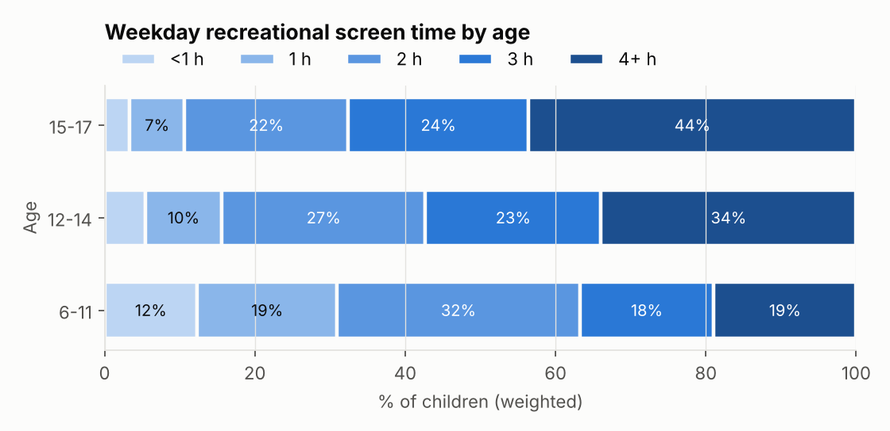
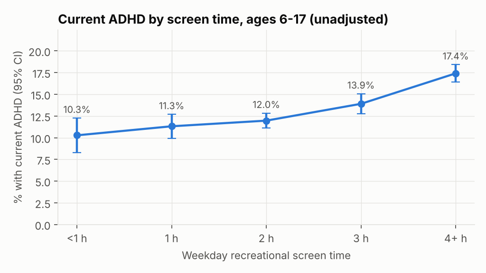
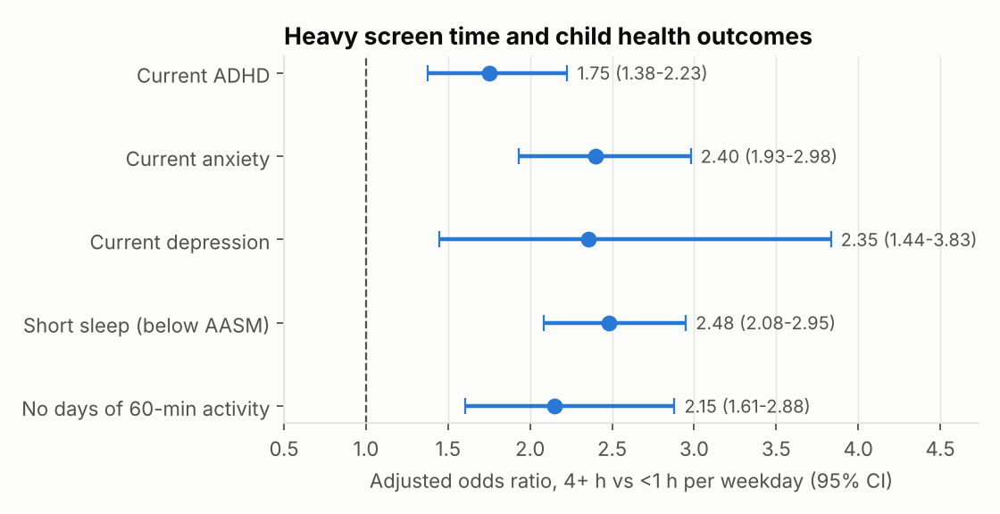
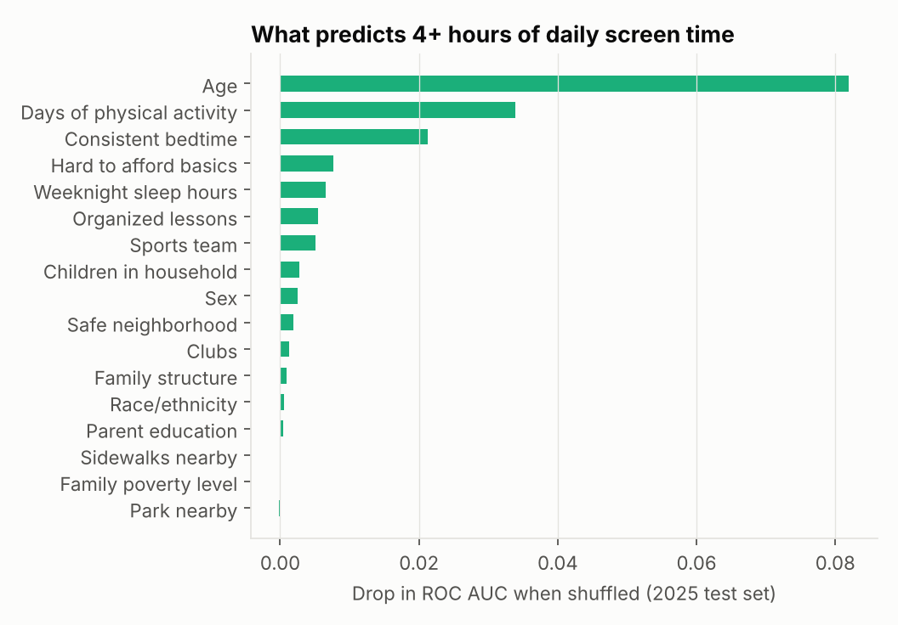

# Screen Time, ADHD and Child Health: National Survey of Children's Health 2024–2025

**Complex survey statistics · weighted logistic regression with design-based SEs · gradient boosting · Python**

How strongly is heavy recreational screen time associated with ADHD and other health outcomes in U.S. children, once family and demographic differences are accounted for? And can we identify which children are most likely to be heavy users?

**Data:** National Survey of Children's Health (NSCH), 2024 and 2025 topical public-use files (U.S. Census Bureau / HRSA). Analytic sample: **69,430 children aged 6–17** with a reported screen-time answer. All estimates are weighted to represent U.S. children.

> **This is an observational, cross-sectional survey.** The results show *associations*, not cause and effect. Children with ADHD may use screens more (reverse causation), and unmeasured factors may drive both.

## Key findings

**1. Heavy use is the norm for teenagers.** 29.2% (±0.7) of children aged 6–17 spend **4+ hours** on a typical weekday on recreational screens (TV, phone, computer, games; schoolwork excluded). That share rises to **34% at ages 12–14 and 44% at ages 15–17**.



**2. ADHD prevalence rises steadily with screen time.** 13.7% of children aged 6–17 currently have ADHD. The rate goes from **10.3% among children with under 1 hour to 17.4% among those with 4+ hours**, and every step up in screen time is higher than the one before.



**3. The association holds after adjustment.** The models control for age, sex, race/ethnicity, family poverty level, parent education, family structure and survey year. Odds ratios compare 4+ hours with under 1 hour:

| Outcome | Adjusted OR (95% CI) |
|---|---|
| Current ADHD | **1.75** (1.38–2.23) |
| Current anxiety | 2.40 (1.93–2.98) |
| Current depression | 2.35 (1.44–3.83) |
| Sleep below AASM recommendation | 2.48 (2.08–2.95) |
| No days with 60 minutes of physical activity | 2.15 (1.61–2.88) |

For ADHD, the association appears at 3 hours (OR 1.38, 1.07–1.77) and grows at 4+ hours. Below 3 hours it isn't statistically different from under 1 hour.



**4. Sleep and activity explain only part of the link.** Also adjusting for short sleep and physical activity, which may lie on the pathway between screen use and symptoms, lowers the ADHD odds ratio from 1.75 to **1.56 (1.22–2.00)**.

**5. Predicting heavy screen use.** A gradient-boosting model was trained on 2024 data and tested on 2025 data. It flags children likely to have 4+ hours using family, activity and neighborhood factors, reaching **ROC AUC 0.72**, against 0.65 for age alone. Logistic regression scored about the same (0.73), which suggests the signal is mostly additive. After age, the strongest predictors are **days of physical activity** and **a consistent bedtime**, both modifiable through family routines. Family income and parent education add little once these are known.



## Methods

- **Outcomes.** "Current" conditions require that a doctor has ever said the child has the condition *and* that the child currently has it. Short sleep uses AASM guidance (9+ hours at ages 6–12, 8+ hours at 13–17).
- **Survey design.** NSCH samples one child per household within state-by-stratum cells. Variances use Taylor linearization with strata = state × sampling stratum × year and households as PSUs, implemented from scratch in `src/analyze.py` with the sandwich estimator `H⁻¹ · V_design(scores) · H⁻¹`. Pooled weights are the child weight divided by 2, following Census guidance for multi-year analysis.
- **Income.** The first imputed poverty ratio (`FPL_I1`) is used. A full analysis would combine all six implicates with Rubin's rules.
- **ML.** Gradient boosting with native categorical handling and survey-weighted training. Testing on the following year guards against overfitting to one survey cycle. Importance is measured by permutation on the test year.

## Reproduce

See [`src/download_data.md`](src/download_data.md) for the two Stata files, then:

```bash
pip install -r requirements.txt
python src/analyze.py --data-dir data
```

Outputs: `reports/metrics.json`, `reports/adjusted_odds_ratios.csv`, `reports/adhd_full_model.csv` and the figures above.

## Source

U.S. Census Bureau and Health Resources and Services Administration, Maternal and Child Health Bureau. *National Survey of Children's Health*, 2024 and 2025 Topical Public Use Files. https://www.census.gov/nsch
